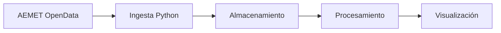

# Proyecto 04 · Urban Valencia

## Descripción y objetivo

Pipeline completo de ingeniería de datos (batch + streaming) sobre datos abiertos de tráfico, calidad del aire y meteorología de Valencia. Los datos se cruzan con Spark y el proyecto termina con dos modelos predictivos: uno principal de NO₂ horario y uno secundario de intensidad de tráfico.

## Arquitectura



## Fuentes de datos

| Fuente | URL / origen | Formato | Frecuencia de actualización | Licencia | Última ingesta |
|---|---|---|---|---|---|
| AEMET OpenData (Predicción por municipio - Valencia) | https://opendata.aemet.es/ | JSON | Única | AEMET | 2026-10-14 |

## Estructura del repositorio

| Carpeta / fichero | Contenido |
|---|---|
| `ingesta/` | Scripts de descarga de fuentes de datos |
| `etl/` | Transformaciones con Spark |
| `dashboard/` | Visualización de resultados |
| `data/raw/` | Datos crudos tal como llegan de la API |
| `data/staged/` | Datos limpios y normalizados |
| `data/curated/` | Datos listos para modelar |
| `.env` | Variables de entorno. Hay que crearlo a partir de `.env.example` |
| `.env.example` | Plantilla de variables de entorno (`API_KEY`, `API_URL`) |

## Cómo desplegar el entorno

```bash
cp .env.example .env     # crea el fichero de variables de entorno (hay que rellenarlo)
```

Todavía no hay entorno Docker: no hay `docker-compose.yaml` ni puertos expuestos. `.env.example` tiene las variables sin valor: hay que rellenar `API_KEY` y `API_URL`.

## Bitácora de prácticas

### Bloque 0 · Entorno

**Objetivo:** crear el repositorio Git, la estructura de carpetas, el `.gitignore`, el entorno Docker y el README.

**Pasos realizados:**

- Creación de las ramas `main` y `develop` para separar el resultado final del desarrollo.
- Creación de la estructura de carpetas.
- Creación del `.gitignore`.
- Creación del `.env.example`.

**Problemas encontrados y solución:** —

**Resultado:** —

## Decisiones técnicas

| Decisión | Alternativa descartada | Motivo |
|---|---|---|
| Ramas `main` y `develop` | Trabajar solo en `main` | Separar el resultado final del desarrollo |

## Incidencias resueltas

## Resultado final
